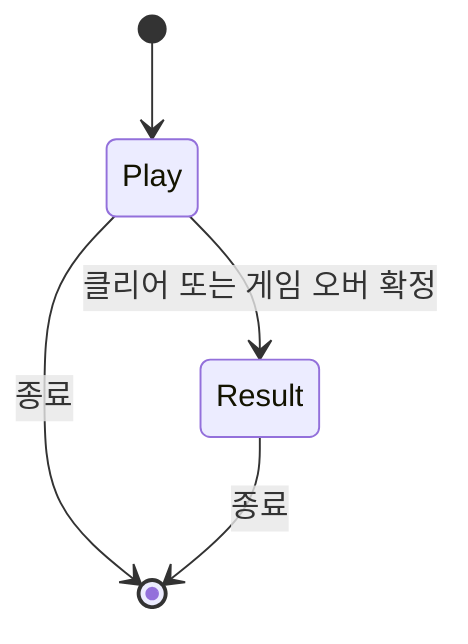
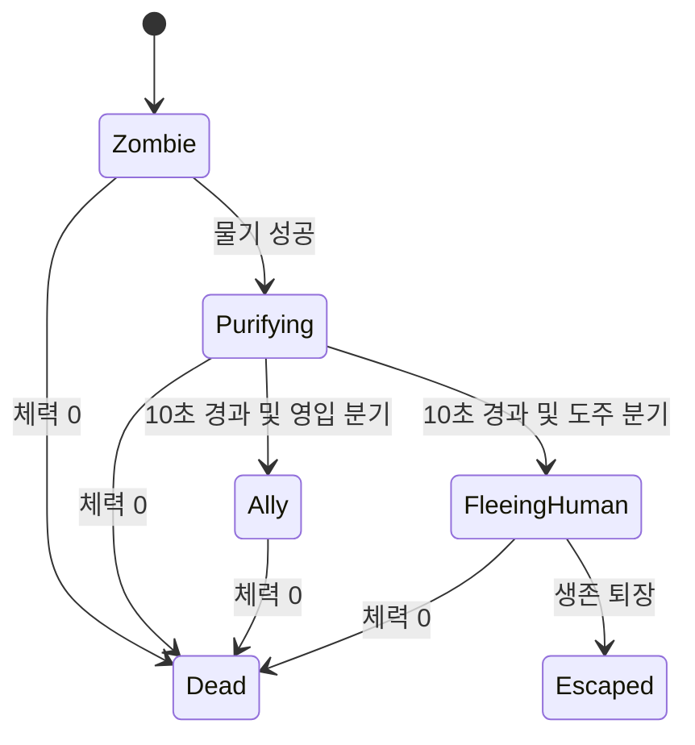
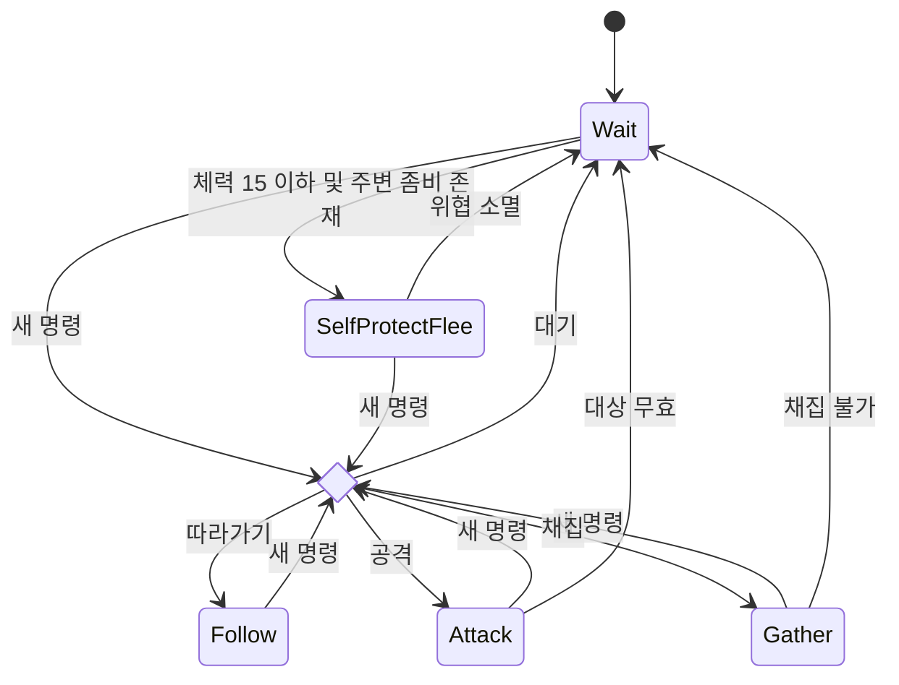

# 이제 누가 좀비지? — 게임 개발 PRD

## 1. 개발 목표와 기준 문서

Python과 pico2d로 제작하는 1인 대학 기말 프로젝트다. 약 4주 동안 플레이어가 마을을 탐색하고, 좀비를 물어 인간으로 회복시키거나 처치하며, 자원과 조력자를 활용해 엔딩에 도달하는 2D 탑뷰 게임 한 판을 완성한다.

작업 시작 전에 [이거기말인가요.md](./이거기말인가요.md) 전체를 읽는다. 특히 게임 컨트롤과 PDF 근거, 구현 제안, 미정 목록을 확인한다. 이 PRD의 임시 기본안은 개발·검증용이다. 해당 규칙은 설정 또는 한 곳의 판정 함수에 모아 최종 결정 때 교체할 수 있게 한다. 두 문서에서 충돌하거나 새로 정해야 하는 사항은 작업 기록에 남긴다.

화면은 800×600이며 주택가·상점가·공원을 포함하는 마을 하나를 사용한다. 주요 건물 6~10개와 초기 좀비 15~25마리를 배치한다. 맵 크기는 기존 초안인 약 2400×1800을 기준으로 잡는다.

## 2. 조작 요구사항

| 입력 | 요구 동작 | 임시 구현 및 확인 기준 |
| --- | --- | --- |
| WASD | 이동 | 누르는 동안 이동하고 대각선 속도를 정규화한다. 키를 떼면 해당 축 이동을 멈춘다. |
| 마우스 이동 | 커서 방향 바라보기 | 커서를 월드 좌표로 환산하고 이동 방향과 독립적으로 커서를 향해 부드럽게 회전한다. 커서가 캐릭터 중심과 겹치면 직전 목표 각도를 유지한다. |
| 숫자키 | 핫바 슬롯 선택 | 슬롯 수는 미정이다. 개발용으로 1~5를 사용하며 빈 슬롯도 선택 가능하게 한다. |
| E | 선택한 아이템 사용 | 임시로 통조림은 섭취하고 바리게이트는 유효한 위치에 설치한다. 빈 슬롯에서는 상태를 유지한다. 도끼류는 선택한 상태로 좌클릭해 사용한다. |
| Q | 선택한 아이템 드롭 | 월드에서 선택한 핫바 아이템을 한 개 떨어뜨린다. 우클릭으로 다시 주울 수 있다. 빈 슬롯이거나 주변에 드롭할 위치가 없으면 보유량을 유지한다. |
| I | 인벤토리 또는 제작 | 임시로 같은 창에서 두 기능에 접근하고 I로 닫는다. |
| 좌클릭 | 공격 | 바라보는 방향의 유효 대상에 한 번 공격한다. 나무를 도끼류로 타격하는 경로를 연결한다. |
| 우클릭 | 상호작용 | 범위 안에서 조력자를 클릭하면 명령 창을 연다. 임시로 월드 아이템 획득에도 사용하며, 조력자 외 대상의 상호작용은 범위와 대상 유효성을 검사한다. |

**물기 입력은 미정이다.** 개발 중에는 임시 B 키를 별도 행동에 연결한다. 테스트할 때 물기와 좌클릭 공격을 각각 재현하고, 정식 입력은 확정 후 변경한다. UI 위 클릭은 해당 창이 소비해 월드 공격이나 상호작용을 중복 실행하지 않게 한다. 명령 창에서는 대기·따라가기·공격·채집을 선택하고, 채집을 고르면 나무·돌멩이 중 하나를 지정하는 안을 사용한다. UI가 열린 동안의 시간 처리는 미정이며, 개발 기본안은 인벤토리·제작 창에서 월드 시간을 멈추고 조력자 명령 창에서는 진행하는 것이다.

## 3. 시스템과 데이터

### 월드와 시간

새 게임은 플레이어, 초기 좀비, 건물 충돌 사각형, 자원 스폰 지점, 파밍 배치와 카메라를 초기화한다. 플레이어와 NPC는 월드 좌표를 사용하며 카메라를 적용할 때만 화면 좌표로 바꾼다. 카메라는 플레이어를 따라가며 맵 경계에서 제한한다. 마우스 좌표는 이 변환을 반대로 적용한다. 게임 로직은 경과 시간 `dt`로 갱신하고, 렌더링은 현재 상태를 그린다.

최소 데이터는 플레이어의 위치·방향·체력·감염·핫바 선택, 개체의 ID·위치·체력·상태·공격 가능 시각, 정화 만료 시각, 조력자 명령·대상 ID, 인벤토리의 아이템별 수량, 배치 ID별 획득 여부, 자원별 활성 수와 재생성 시각이다. 종료 판정용으로 초기 좀비 ID와 각 개체의 최종 상태를 유지한다. 이미지 로딩과 게임 규칙을 분리해 임시 도형으로도 플레이할 수 있게 한다.

### 마우스 조준과 연속 회전

플레이어의 목표 각도는 플레이어 중심에서 월드 커서로 향하는 벡터의 각도다. 원본 스프라이트가 화면 위쪽을 향하므로, 오른쪽이 0도인 수학 좌표의 각도에서 90도를 빼 렌더링 기준을 맞춘다. 회전은 현재 각도와 목표 각도의 차를 -180도 이상 180도 미만으로 접은 뒤 경과 시간에 맞춰 보간한다. 359도에서 1도로 갈 때 짧은 경로를 타고 프레임 속도가 바뀌어도 비슷한 시간에 수렴해야 한다. 이동·정지·공격·물기 중에도 커서를 추적한다. 공격 판정은 입력 시점의 커서 방향을 저장하고, 개발 기본안으로 해당 공격의 유효 프레임에서 한 번 판정한다. 캐릭터 몸체는 셀 중앙을 기준으로 회전한다. 장착 무기는 6.4절의 별도 시트에서 가져와 회전한 손 위치에 배치하고 휘두르기 각도를 더한다. 좌우 이동 중에도 조준 방향이 유지되는지, 카메라 경계와 건물 내부에서 클릭 좌표가 맞는지 확인한다.

### 전투, 물기, 회복

- 좀비 체력은 50이다. 플레이어와 같거나 조금 느리거나 조금 빠른 속도 유형을 둔다. 범위에 들어오면 피해 5를 주고 같은 좀비의 다음 타격까지 2초를 적용한다. 공격 거리, 감지 거리, 최초 타격과 다중 피격 정책은 미정이다.
- 살아 있는 유효 좀비를 물면 감염 +10, 정화 타이머 10초를 적용한다. 개발 기본안은 정화 중인 좀비를 재차 물어도 변화가 없고, 정화가 끝날 때까지 좀비로 행동하며 공격으로 죽을 수 있게 하는 것이다. 사망 시 예약된 정화를 취소하고, 정화 완료와 사망이 겹치면 개발용으로 사망을 먼저 처리한다.
- 감염과 플레이어 체력 범위는 각각 0~100이다. 플레이어 시작값은 임시로 감염 0, 체력 100이다. 감염은 플레이 시간 1분당 2 감소하고, 100 도달 시 좀비화한다. 음식은 감염 -20과 체력 +30을 함께 적용한다. 개발용 음식인 통조림은 사용 성공 때 1개 차감한다. 체력이 0이면 사망한다.
- 정화 완료 시 50%는 도망가고 50%는 조력자가 된다. 판정은 개체당 한 번이다. 회복된 사람은 재감염되지 않으며 체력이 0이면 사망한다. 조력자는 대기 중 자기보호, 플레이어 추종, 플레이어가 공격하는 좀비 공동 공격, 지정 자원 채집을 수행한다. 대상이 사라지면 행동을 종료한다. 채집 보상은 개발용으로 플레이어에게 직접 지급하고, 같은 자원을 두 번 얻지 않게 한다.

### NPC 공격력

| NPC | 적중당 피해 | 같은 개체의 공격 간격 | 기준 |
| --- | ---: | ---: | --- |
| 좀비 | 5 | 2초 | 기획서 확정 |
| 인간 조력자 | 5 | 2초 | 개발용 초안. 플레이어 맨손과 같은 피해량 |
| 도망가는 인간 | 공격 없음 | 해당 없음 | 개발용 초안. 도주 행동만 수행 |

조력자는 공동 공격 명령의 유효 대상에 접촉 프레임당 한 번만 피해를 준다. 대기 중에는 아래의 저체력 자기보호 규칙을 적용한다. 조력자가 단독으로 체력 50인 좀비를 10회 적중하면 처치되는지, 같은 조력자의 연속 적중 간격이 2초 이상인지, 대상이 정화되면 공격을 중단하는지 확인한다.

### NPC 체력과 자기보호

좀비의 최대·초기 체력은 기획서 기준 50이다. 회복된 인간의 최대·초기 체력은 개발용으로 50을 적용한다. 정화 완료 시 조력자와 도망가는 인간 모두 체력 50으로 시작하며, 정화 전 좀비의 남은 체력은 이어받지 않는다. 좀비 공격이 적중하면 5 감소하고 체력 0에서 사망한다.

대기 명령을 받은 조력자는 체력이 15 이하이고 주변에 살아 있는 좀비가 있을 때 자기보호 행동으로 도망간다. 가장 가까운 위협에서 멀어지는 방향으로 이동하고 맵·벽 충돌을 적용한다. 주변 위협이 사라지면 멈추고 현재 위치에서 대기한다. 도망 중에도 영입 상태와 대기 명령을 유지하며 새 명령을 받을 수 있다. 정화 직후 조력자가 되지 않고 도망가는 인간의 분기는 그대로 적용한다. 체력 15와 위협 감지 범위는 개발용 조정값이다.

체력 20에서는 대기하고, 15에서는 주변 좀비가 있을 때 도망가는지 확인한다. 위협이 없으면 체력 15여도 대기하며, 도주 중 체력 0이면 사망한다. 위협이 사라지거나 새 명령을 받으면 자기보호 도주를 종료한다.

### 플레이어 공격력 초안

| 장비 | 적중당 피해 | 체력 50인 좀비 처치에 필요한 적중 |
| --- | ---: | ---: |
| 맨손 | 5 | 10회 |
| 나이프 | 10 | 5회 |
| 돌도끼 | 13 | 4회 |
| 못이 박힌 방망이 | 17 | 3회 |
| 도끼 | 25 | 2회 |

개발용 수치다. 맨손으로도 처치할 수 있고, 제작 무기와 획득 무기는 필요 적중 횟수로 차이를 느낄 수 있게 잡았다. 첫 검증에서는 같은 공격 간격을 적용하고, 플레이테스트 후 무기별 간격과 피해를 조정한다. 좌클릭 시 장비를 기록하고 공격의 접촉 프레임에서 대상에게 피해를 한 번 적용한다. 물기는 별도의 정화 행동이다. 가로수 채집은 도끼류 적합 여부로 판정한다. 테스트에서는 체력 50에서 표의 횟수만큼 맞혔을 때 사망하는지, 한 번 덜 맞히면 생존하는지 확인한다.

### 아이템과 제작

| 분류 | 아이템 | 처리 |
| --- | --- | --- |
| 채집 | 나무, 돌멩이 | 나무는 가로수를 도끼류로 타격해 얻고 돌멩이는 집 밖에서 줍는다. 활성 개수에 상한을 두고 빈 지점에서 재생성한다. |
| 파밍 | 도끼, 못, 테이프, 통조림 | 배치에서 한 번 획득하면 그 판에서 재생성되지 않는다. |
| 좀비 사망 드롭 | 도끼, 나이프, 통조림 | 사망 이벤트 한 번에만 드롭을 판정한다. 정화는 개발 기본안에서 드롭을 만들지 않는다. |
| 제작 | 돌도끼, 못이 박힌 방망이, 바리게이트 | 돌도끼는 나무·돌멩이·테이프, 방망이는 나무·못을 요구하며 수량은 미정이다. 바리게이트는 나무 3개와 못 2개를 요구한다. |

제작은 전체 재료를 확인한 뒤 한 번에 차감한다. 설치는 맵 경계, 장애물과 개체 겹침을 확인한 뒤 수량을 차감한다. 부족·실패 시 수량을 보존한다. PDF의 희귀 파밍 드롭 설명과 나이프 목록은 충돌한다. 개발 중에는 명시된 두 목록을 그대로 설정에 등록하며, 최종 분류는 확인이 필요하다.

### 종료

남은 좀비 0마리에서 생존이 절반을 초과하면 해피엔딩, 절반 이하면 새드엔딩이다. 개발용으로 정화 중인 개체는 남은 좀비에 포함하며, 초기 좀비 수 대비 종료 시 살아 있는 회복자 수를 센다. 살아서 퇴장한 회복자는 생존에 포함한다. 체력 0은 사망 게임 오버, 감염 100은 좀비화 게임 오버다. 결과는 한 번만 확정하고 이후 월드 입력과 갱신을 멈춘다. 동시 조건 우선순위는 미정이며 개발용으로 사망 → 좀비화 → 클리어 순서로 재현 가능하게 처리한다.

## 4. 구현 순서와 검수 기준

| 단계 | 일정 및 선행 조건 | 완료 기준 |
| --- | --- | --- |
| 1. 실행 루프·입력·맵 | 1주차. pico2d 창, 시간 갱신, 임시 도형, 이동·카메라·충돌, 좀비 추적 순 | WASD 이동과 커서 조준이 독립적으로 동작하고 카메라 이동 후에도 커서 방향을 추적한다. 각도 경계를 넘을 때 부드럽게 회전한다. 벽·맵 밖 통과가 없고 좀비 속도 세 유형이 구분된다. |
| 2. 정화·감염 | 1~2주차. ID·시간 갱신과 입력 사용 | 9.9초에는 정화되지 않고 10초에 한 번만 전환한다. 중복 물기로 초기화되지 않는다. 60초간 -2이며 100에서 종료한다. |
| 3. 전투·아이템·UI | 2주차. 개체 상태·입력 사용 | 좀비 피해 5의 간격이 2초다. 0 체력에서 사망 처리와 드롭이 한 번만 발생한다. 숫자키·E·I가 연결되고, 음식 1개로 +30/-20이 적용되며 값은 범위 안에 머문다. |
| 4. 채집·제작·설치 | 3주차. 충돌·인벤토리 사용 | 자원 재생성이 상한을 넘지 않는다. 파밍은 재생성되지 않는다. 바리게이트 비용은 나무 3·못 2이며 설치 실패 시 보유량이 유지된다. |
| 5. 인간·조력자 | 3~4주차. 정화·전투·채집 사용 | 고정한 난수로 두 분기를 각각 재현한다. 우클릭으로 창이 열리고 네 명령이 작동한다. 대상 소멸과 동시 채집을 검증한다. |
| 6. 엔딩·이미지·통합 | 4주차. 위 단계 완료 후 이미지 교체와 밸런스 검증 | 좀비가 남으면 계속 진행한다. 초기 20명 중 생존 11명은 해피, 10명은 새드다. 두 게임 오버와 동시 조건에서 결과가 한 번만 확정된다. 실제 플레이로 시작부터 종료까지 확인한다. |

검수 시 실행 진입점과 실행 명령, 사용한 임시 기본값, 재현 절차를 기록한다. 최종 결정 대상으로 물기·핫바·픽업 조작, UI 시간 처리, 전투 거리·피해량·속도, 정화 중 행동, 조력자 자기보호 수치와 도망자 퇴장, 자원 상한·재생성·드롭률·제작 수량, 바리게이트 통과·파괴, 생존 집계·종료 우선순위, 고감염 시야 방해 여부를 추적한다.

## 5. 필수 Git 작업 방식

**AI 개발자는 코드를 작성하면서 실제로 점진적 커밋을 만든다. 한 단계나 기능 전체를 작성한 뒤 한 번에 커밋하는 방식은 이 프로젝트의 요구를 충족하지 않는다.** 아래 주기를 각 클래스와 함수에 반복한다.

1. 작업 전 `git status --short`로 기존 변경을 확인한다. 현재 작업에 해당하는 파일 또는 변경 부분만 스테이징한다.
2. 클래스 하나의 선언과 `pass`만 작성한다. 문법을 확인하고 즉시 커밋한다.
3. 그 클래스에 함수 시그니처 하나와 본문의 `pass`를 추가한다. 문법을 확인하고 즉시 커밋한다. 다른 함수도 한 개씩 반복한다.
4. 함수 하나의 본문을 구현한다. 해당 동작을 독립적으로 확인하고 즉시 커밋한다. 함수가 크면 검증 가능한 동작 하나씩 구현하고 그때마다 커밋한다.
5. 완성한 함수를 게임 루프나 입력에 연결하는 변경을 별도로 검증하고 커밋한다. 실행 중인 코드가 아직 `pass`인 함수의 결과에 의존하지 않게 한다.
6. 다음 변경 전에 `git diff --cached`로 범위를 점검하고 `git log -1 --oneline`으로 커밋 성공을 확인한다. 커밋이 실패하면 원인을 해결하고 해당 커밋부터 마친다.

모든 커밋 메시지는 변경 내용을 구체적으로 설명하는 한국어 제목으로 작성한다. 클래스·함수 식별자는 원래 이름을 사용할 수 있다. 예를 들어 플레이어 클래스부터 시작한다면 다음은 각각 독립된 실제 커밋이다.

| 순서 | 커밋 예시 | 포함 변경 |
| --- | --- | --- |
| 1 | `Player 클래스 뼈대 추가` | `class Player:`와 `pass` |
| 2 | `Player 초기화 메서드 선언` | `__init__` 시그니처와 `pass` |
| 3 | `플레이어 초기 상태 설정` | `__init__` 본문 |
| 4 | `플레이어 이동 메서드 선언` | 이동 메서드 시그니처와 `pass` |
| 5 | `플레이어 이동 동작 구현` | 이동 메서드 본문 |
| 6 | `WASD 입력을 플레이어 이동에 연결` | 입력과 이동 연결 및 동작 확인 |

스텁은 예를 들어 `python -m py_compile 파일.py`로 확인한다. 동작 커밋은 해당 단계의 수동 검수나 기존 테스트를 사용한다. 서로 무관한 함수·이미지·설정 변경은 별개 커밋으로 남긴다. 사용자 변경을 함께 스테이징하거나 이미 만든 단계별 커밋을 합치지 않는다.

## 6. 현재 에셋과 pico2d 통합 명세

### 6.1 로딩, 좌표와 회전

- 아래 경로는 `PRD.md`가 있는 프로젝트 루트 기준이다. 실행 위치가 바뀌어도 찾도록 게임 진입 파일에서 프로젝트 루트를 구하고 에셋 경로를 조합한다. 이미지는 경로별로 한 번만 로드한다. 위치, 애니메이션 시각, 프레임, 회전각, 체력은 개체별로 관리한다.
- 시트의 행과 열은 각각 위와 왼쪽에서 0부터 센다. 행 `r`, 열 `c`, 셀 너비 `w`, 셀 높이 `h`, PNG 높이 `H`일 때 이미지 왼쪽 위 기준 사각형은 `(c*w, r*h, w, h)`다. pico2d의 `clip_draw` 및 `clip_composite_draw`용 소스 사각형은 `(c*w, H-(r+1)*h, w, h)`다. 이 변환은 잘라낼 원본 위치에만 적용한다. 투명한 빈 셀은 건너뛴다.
- 캐릭터와 무기 원본은 화면 위쪽을 향한다. Y가 위로 증가하는 월드에서 `theta = atan2(dy, dx) - pi/2`를 사용하고 pico2d 회전 인자에는 라디안을 전달한다. 캐릭터는 셀 중심 (32, 32)을 기준으로 회전한다. 카메라 좌하단이 `(cam_x, cam_y)`이면 월드 점을 `(world_x-cam_x, world_y-cam_y)`에 그린다. 화면의 클릭을 월드로 되돌릴 때는 카메라 좌표를 더한다.
- 확대·축소에는 최근접 보간을 사용한다. 실제 셀 중심을 유지하도록 알파 경계에 맞춰 캐릭터 프레임을 개별 크롭하지 않는다. 로드 실패 시 해당 에셋 경로를 기록하고 같은 중심과 충돌 범위를 가진 임시 도형으로 대체한다.

### 6.2 플레이어 몸체

`assets/characters/player.png`는 RGBA 256×1408이다. 64×64 셀 4열×22행, 실제 프레임 49개다. 각 행은 아래 지정된 열만 사용한다. 표의 y는 pico2d 소스 y다. 열 0~3의 소스 x는 각각 0, 64, 128, 192다.

| 행 | y | 프레임 수 | 유효 열 | 동작과 용도 |
| --- | ---: | ---: | --- | --- |
| 0 | 1344 | 1 | 0 | 기본 대기 및 장착 중 정지 몸체 |
| 1 | 1280 | 4 | 0–3 | 걷기 반복. 이동 중 조준 방향 유지 |
| 2 | 1216 | 3 | 0–2 | 공격 준비·접촉·복귀. 1열에서 피해 판정 |
| 3 | 1152 | 3 | 0–2 | 팔 뻗기·물기 접촉·놓기. 1열에서 정화 판정 |
| 4 | 1088 | 1 | 0 | 붉은 피격 표시. 피해를 받은 직후 짧게 표시 |
| 5 | 1024 | 1 | 0 | 사망 표시 |
| 6–9 | 960 / 896 / 832 / 768 | 1 / 1 / 4 / 3 | 0 / 0 / 0–3 / 0–2 | 나이프용 기존 행. 순서대로 장착 전환·대기·걷기·공격 |
| 10–13 | 704 / 640 / 576 / 512 | 1 / 1 / 4 / 3 | 0 / 0 / 0–3 / 0–2 | 돌도끼용 기존 행. 같은 순서 |
| 14–17 | 448 / 384 / 320 / 256 | 1 / 1 / 4 / 3 | 0 / 0 / 0–3 / 0–2 | 못 박힌 방망이용 기존 행. 같은 순서 |
| 18–21 | 192 / 128 / 64 / 0 | 1 / 1 / 4 / 3 | 0 / 0 / 0–3 / 0–2 | 도끼용 기존 행. 같은 순서 |

6~21행은 행 번호 호환용 몸체 복제본이다. 각 4행 묶음의 원본은 0, 0, 1, 2행 순이다. 신규 구현에서는 기본 몸체 0~5행을 선택하고 장착 무기를 별도 레이어로 그린다. 물기 접촉 셀의 pico2d 사각형은 `(64, 1152, 64, 64)`다. 실제 좀비 개체를 평소 월드 레이어에서 그린다. 해당 개체가 접촉 시점에 살아 있고 유효한 거리와 방향 안에 있으면 한 번만 정화 판정을 한다. 공격·물기는 1회 재생하고 완료 후 대기나 걷기로 복귀한다. 시간이 크게 진행되어 접촉 셀을 건너뛰어도 접촉 시각을 지났는지 검사해 판정을 한 번 실행한다.

### 6.3 NPC 몸체와 정화

| 경로 | PNG 규격 | 프레임 수 | 용도 |
| --- | --- | ---: | --- |
| `assets/characters/zombie_01.png` | 256×320 | 10 | 붉은 체크 셔츠 좀비 |
| `assets/characters/zombie_02.png` | 256×320 | 10 | 푸른 재킷 좀비 |
| `assets/characters/zombie_03.png` | 256×320 | 10 | 보라색 옷 좀비 |
| `assets/characters/human_01.png` | 256×384 | 12 | 01번 좀비의 회복 외형 |
| `assets/characters/human_02.png` | 256×384 | 12 | 02번 좀비의 회복 외형 |
| `assets/characters/human_03.png` | 256×384 | 12 | 03번 좀비의 회복 외형 |

전부 RGBA, 셀 64×64, 4열이다. 소스 x는 `64*열`이다.

| 행 | 유효 열 | 좀비 동작 / pico2d y | 인간 동작 / pico2d y |
| --- | --- | --- | --- |
| 0 | 0 | 대기 1 / 256 | 대기 1 / 320 |
| 1 | 0–3 | 걷기 4 / 192 | 걷기 4 / 256 |
| 2 | 0–2 | 공격 3 / 128 | 공격 3 / 192 |
| 3 | 좀비 0, 인간 0–1 | 뼈 사망 1 / 64 | 채집 2 / 128 |
| 4 | 0 | 붉은 피격 1 / 0 | 뼈 사망 1 / 64 |
| 5 | 인간 0 | 해당 없음 | 붉은 피격 1 / 0 |

피격 행은 대기 자세를 붉게 물들인 1프레임이다. 생존 NPC가 피해를 받으면 짧게 표시하고 기존 상태의 시각으로 복귀한다. 좀비·인간 모두 피격 소스 사각형은 `(0, 0, 64, 64)`다. 체력이 0이면 피격보다 사망을 우선하고 해골과 뼈가 있는 1프레임을 시체의 월드 중심에 그린다. 두 계열 모두 사망 소스 사각형은 `(0, 64, 64, 64)`다. 뼈에는 장착 무기와 정화 타이머를 겹치지 않는다. PNG 위에서 센 기존 행 번호는 그대로이며, 높이가 64px 늘어 기존 행의 pico2d 소스 y는 각각 64px 증가했다.

NPC 공격 1열은 접촉이다. 인간 채집 1열을 개발용 채집 접촉으로 사용한다. 수량과 피해는 게임 상태의 접촉 이벤트에서 갱신한다. 좀비 속도 유형은 외형과 별도 데이터다. 정화 중에는 좀비 몸체 위에 정화 아이콘과 남은 시간을 표시한다. 정화가 끝나면 외형 번호가 같은 인간 시트로 전환한다. 조력자와 도망자는 인간 시트를 공유한다.

### 6.4 장착·휘두르기 무기 레이어

`assets/items/weapons.png`는 RGBA 256×128, 64×64 셀 4열×2행이다. 무기별 장착용 1개와 휘두르기용 1개가 들어 있다. 각 셀의 그립 중심은 (32, 32)이고 무기 끝은 위를 향한다.

| 열 | pico2d x | 무기 |
| --- | ---: | --- |
| 0 | 0 | 나이프 |
| 1 | 64 | 돌도끼 |
| 2 | 128 | 못 박힌 방망이 |
| 3 | 192 | 도끼 |

| 행 | pico2d y | 용도 |
| --- | ---: | --- |
| 0 | 64 | 장착 중 대기·걷기 |
| 1 | 0 | 공격 중 각도를 보간해 휘두르기 |

1. 개체의 몸체를 먼저 그린다. 로컬 손 위치의 개발 시작값은 대기·걷기 `(12, 0)`, 공격 0~2열 `(12, 4)`, `(12, 16)`, `(12, 7)`이다. X는 오른쪽, Y는 위쪽이며 단위는 원본 셀 픽셀이다. 렌더링 배율을 곱하고 몸체 각도 `theta`로 회전한 뒤 개체의 위치에 더해 그립 위치를 구한다.
2. 무기 셀을 잘라 그립 위치를 중심으로 그린다. 무기 회전각은 `theta + swing_angle`이다. 장착 상태는 `swing_angle=0`, 공격 중에는 예를 들어 -65° → 0° → +65°를 준비·접촉·복귀에 맞춰 보간한다. 장착·휘두르기 이미지는 각각 한 셀이므로 중간 각도는 Python에서 만든다.
3. 플레이어와 NPC에 같은 렌더링 함수를 사용한다. 플레이어는 마우스 조준, NPC는 대상 방향에서 몸체 각도를 구한다. 개체가 무기를 장착한 상태에서만 레이어를 표시한다. NPC 장착 여부와 전투 수치는 게임 규칙에서 결정한다. 물기 중에는 손이 대상에 닿는 자세를 표시할 수 있도록 무기 레이어를 숨긴다.
4. 무기 레이어의 시각적 겹침과 별도로, 3절의 범위·방향·접촉 시각 규칙에 따라 공격을 판정한다. 그리기 함수에서는 피해와 내구도 등 게임 상태를 변경하지 않는다.

### 6.5 월드 지면, 건물과 소품

`assets/world/ground.png`는 RGB 2400×1800 단일 지면 이미지다. 도로, 인도, 잔디와 공원 산책로가 포함된다. 화면 800×600에서 확대 없이 그릴 때 카메라 좌하단 범위는 x 0~1600, y 0~1200이다. 배경을 부분 렌더링할 때 pico2d에 `(cam_x, cam_y, 800, 600)`을 원본 사각형으로 전달하고 화면 중심 (400, 300)에 그린다.

| 지붕 | 내부 | 공통 크기 | 출입구 기준 |
| --- | --- | --- | --- |
| `assets/world/buildings/house_small_roof.png` | `assets/world/buildings/house_small_interior.png` | 192×144 | 남쪽, 이미지 왼쪽 기준 x=96 부근 |
| `assets/world/buildings/house_corner_roof.png` | `assets/world/buildings/house_corner_interior.png` | 216×176 | ㄱ자 건물의 남쪽, 이미지 왼쪽 기준 x=70 부근 |
| `assets/world/buildings/shop_roof.png` | `assets/world/buildings/shop_interior.png` | 264×184 | 남쪽, 이미지 왼쪽 기준 x=132 부근 |

각 건물의 두 RGBA 이미지를 같은 크기와 같은 월드 중심에 배치한다. 건물 내부로 들어가면 해당 건물의 지붕을 숨기고 내부와 가구를 표시한다. 출입구는 중심 기준 폭 약 28px의 시각적 기준이다. 위 표의 x는 스프라이트 로컬 좌표이며 월드 좌표는 배치 원점을 더한다. 벽, 문 통과 영역, 가구 충돌, 파밍 위치와 배치 좌표는 게임 데이터로 정의하고 이미지와 맞춘다. ㄱ자 외곽은 여러 직사각형으로 나눈다. 초기 구현은 소형 주택과 상점 한 채에서 문과 지붕 전환을 검증한 뒤 세 종류를 재사용해 6~10채를 구성한다.

| 경로 | RGBA 크기 | 용도 |
| --- | --- | --- |
| `assets/world/props/tree.png` | 111×112 | 가로수. 도끼류 채집 대상. 시각적 수관과 통행을 막는 줄기 영역을 따로 설정 |
| `assets/world/props/barricade.png` | 64×61 | 설치에 성공한 바리게이트의 월드 이미지 |
| `assets/world/props/shelf.png` | 56×48 | 상점 매대. 파밍 지점과 통로를 배치할 때 사용 |
| `assets/world/props/checkout.png` | 72×53 | 상점 계산대 |
| `assets/world/props/table.png` | 64×43 | 실내 탁자 |

지면 → 건물 내부와 바닥 → 배치 가구·픽업·캐릭터·무기 → 지붕 및 필요한 가림 레이어 → 월드 표시 → 화면 UI 순으로 그린다. 내부 가구와 픽업은 해당 건물의 표시 상태에 맞춰 렌더링한다. 배치 중심, 충돌 사각형, 상호작용 범위는 개체 데이터에서 정의한다.

### 6.6 픽업 및 아이템 아이콘

`assets/items/items.png`는 RGBA 160×64, 32×32 셀 5열×2행이다. 월드 픽업, 퀵바, 인벤토리, 제작 결과와 재료 표시에 재사용한다.

| 행 | pico2d y | 열 0 / x=0 | 열 1 / x=32 | 열 2 / x=64 | 열 3 / x=96 | 열 4 / x=128 |
| --- | ---: | --- | --- | --- | --- | --- |
| 0 | 32 | 나무 | 돌멩이 | 도끼 | 못 | 테이프 |
| 1 | 0 | 통조림 | 나이프 | 돌도끼 | 못 박힌 방망이 | 바리게이트 |

아이템 ID를 아이콘 좌표와 매핑한다. 무기 아이템은 별도로 6.4의 무기 열도 지정한다. 예를 들어 도끼 아이콘은 `(64, 32, 32, 32)`, 장착용 도끼는 `(192, 64, 64, 64)`다. 설치한 바리게이트는 월드 소품 이미지를 쓴다.

### 6.7 UI 이미지와 상호작용

모든 UI PNG는 RGBA다. 아래의 위치는 각 PNG 왼쪽 위를 원점으로 한 픽셀 좌표다. 패널을 화면의 중심 `(cx, cy)`에 그릴 때 왼쪽 위는 `(cx-W/2, cy+H/2)`다. 화면 좌표 `(sx, sy)`에서 패널 로컬 좌표를 구할 때 `local_x=sx-(cx-W/2)`, `local_y=(cy+H/2)-sy`를 사용한다. 배율이 적용되면 두 값을 해당 배율로 나눈다.

| 경로 | 규격 | 용도와 배치 |
| --- | --- | --- |
| `assets/ui/quickbar.png` | 282×64 | 슬롯 5개. i번 슬롯의 왼쪽 위는 `(9+54*i, 8)`, 크기 48×48, i=0~4. 화면 하단 중앙에 배치 |
| `assets/ui/inventory.png` | 350×258 | 6열×3행, 18칸. 슬롯 왼쪽 위 `(16+54*c, 49+54*r)`, 크기 48×48. 상단 제목 영역 (9,10)~(340,38), 하단 상태 영역 (16,219)~(333,240) |
| `assets/ui/crafting.png` | 440×280 | 레시피 카드 3개, 왼쪽 위 `(20, 56+63*i)`, 너비 134, 높이 56. 결과 슬롯 (183,59), 크기 48×48. 재료 줄 왼쪽 위 `(184,121+29*i)`, 너비 231, 높이 22. 제작 버튼 (293,222)~(414,251) |
| `assets/ui/panel.png` | 320×224 | 조력자 명령창과 엔딩 등의 공용 패널 배경. 메뉴별 제목과 버튼은 코드로 배치 |
| `assets/ui/slot.png` | 48×48 | 독립 기본 슬롯. 퀵바와 인벤토리 바탕에 이미 기본 슬롯이 포함됨 |
| `assets/ui/slot_selected.png` | 48×48 | 선택된 슬롯 위에 겹치는 상태 이미지. 그 위에 아이콘과 수량을 그린다 |
| `assets/ui/health.png` | 24×22 | 왼쪽 상단 HUD 체력 아이콘 |
| `assets/ui/infection.png` | 24×24 | 왼쪽 상단 HUD 감염 아이콘 |
| `assets/ui/purifying.png` | 24×24 | 정화 중인 좀비 위에 표시하는 월드 아이콘 |

- 퀵바에 1~5번, 아이콘, 수량을 코드로 그린다. 빈 슬롯도 선택 테두리를 표시한다. 인벤토리를 열고 아이템을 핫바로 드래그하면 배정된다. 이미 사용 중인 슬롯에 놓으면 교체되며, 핫바 슬롯끼리 드래그하면 서로 교환한다. 핫바에서 인벤토리로 끌어다 놓으면 배정이 해제되고 보유량은 유지된다. HUD 오른쪽 위에 남은 좀비 수를 표시한다.
- I 창에서 인벤토리와 제작 화면을 오갈 수 있게 한다. 제작창의 결과 및 재료별 보유량/필요량을 코드로 표시하고, 재료 부족 시 제작 버튼을 비활성화한다. 그림의 버튼 영역과 클릭 판정이 같은 좌표를 사용하도록 배치 데이터를 공유한다.
- 조력자 메뉴는 공용 패널에 대기·따라가기·공격·채집과 채집 자원 선택을 그린다. 패널 전체를 화면 안에 배치하고 UI가 소비한 입력은 월드로 넘기지 않는다.
- 체력·감염 막대, 버튼 문구, 수량, 조력자 명령, 엔딩 문구는 코드로 그린다. 현재 한글 폰트 파일과 엔딩 전용 배경은 에셋에 포함되어 있지 않다. 배포 가능한 한글 폰트를 준비하고 pico2d에서 한글 렌더링을 확인한다. 종료 화면은 공용 패널과 결과 텍스트로 구성한다.

### 6.8 통합 검수

1. 파일 크기, RGBA 투명도, 행별 유효 셀을 확인한다. 시트 첫 행과 마지막 행을 실제 화면에 그려 y 방향을 검증한다.
2. 플레이어와 NPC를 네 방향으로 회전시켜 몸체 중심과 무기 그립이 유지되는지 확인한다. 장착 상태와 휘두르기 상태를 각각 확인하고, 공격·물기 접촉 이벤트가 여러 화면 프레임에 걸쳐도 한 번만 처리되는지 검증한다.
3. 정화 중 아이콘과 카운트다운, 동일 번호 인간으로의 전환을 확인한다. 물기 도중 실제 대상 좀비와 플레이어 프레임의 겹침을 확인한다.
4. 건물 지붕과 내부의 배치 원점, 문 통과와 벽 충돌, 내부의 픽업과 조력자 클릭을 확인한다. 카메라가 맵 경계에 있을 때도 월드 클릭이 맞는지 확인한다.
5. 퀵바 번호 선택과 선택 테두리, 인벤토리 슬롯 클릭, 제작 버튼 영역·활성 상태, 명령창 입력 소비를 800×600 화면에서 확인한다. 에셋 변경과 게임 코드 연결은 별개 한국어 커밋으로 기록한다.

## 7. 코딩 방식과 게임 프레임워크

### 객체지향 구조

| 객체 | 책임 |
| --- | --- |
| `GameFramework` | pico2d 창과 루프 관리, 입력 전달, 프레임 시간 계산, 게임 모드 전환 |
| `PlayMode`, `ResultMode` | 플레이 화면과 결과 화면의 입력·갱신·그리기. 공통 인터페이스는 `enter`, `exit`, `handle_events`, `update(dt)`, `draw` |
| `World` | 개체 등록과 조회, 맵 충돌, 카메라, 상태 전환과 종료 판정 조율 |
| `Player`, `Zombie`, `HumanNPC` | 각자의 위치·체력·상태를 소유하고 입력 또는 AI에 따라 행동. 공통 피격과 애니메이션은 재사용 |
| `Inventory`, `Animator` | 각각 아이템 수량·제작 처리, 동작별 스프라이트 프레임 선택 담당 |

플레이어와 NPC의 행동은 객체 메서드에 둔다. 인벤토리·애니메이터는 필요한 객체가 구성 요소로 보유한다. 월드에서 NPC의 행동 대상을 ID로 조회하고, 개체 추가와 제거는 순회가 끝난 뒤 적용한다. 개발 순서는 프레임워크와 임시 모드 → 월드와 플레이어 → 좀비와 정화 → 인간 NPC와 결과 모드다. 클래스 선언, 메서드 선언, 본문 구현, 연결은 5절의 한글 점진적 커밋 규칙을 따른다.

### Python 파일 분리와 실행 진입점

주요 객체의 클래스는 책임별로 각각 별도의 Python 파일에 정의한다. 예를 들어 `GameFramework`는 `game_framework.py`, `World`는 `world.py`, `Player`는 `player.py`, `Zombie`는 `zombie.py`, `HumanNPC`는 `human_npc.py`에 둔다. 화면 모드와 인벤토리·애니메이터도 각각 `play_mode.py`, `result_mode.py`, `inventory.py`, `animator.py`에 둔다.

프로젝트 루트에 별도 `main.py`를 두고 `python main.py`로 실행한다. `main.py`는 `if __name__ == "__main__":`에서 프레임워크와 초기 모드를 준비해 실행한다. 각 객체의 행동과 게임 규칙은 해당 모듈에서 구현한다. 개별 모듈을 import할 때 창을 열거나 게임 루프를 시작하지 않는다.

### 프레임별 실행 순서

1. 루프 한 바퀴마다 경과 초 `dt`를 계산하고 pico2d 이벤트를 한 번 수집한다. 이동은 키의 눌림 상태를, 공격·물기·상호작용은 입력 이벤트를 사용한다.
2. 현재 모드에 입력을 전달하고 `update(dt)`를 한 번 실행한다. 이동량은 매 프레임 `속도 × dt`로 계산하며 회전, 충돌, 공격, 정화 타이머를 월드 갱신에서 처리한다. 모드 전환은 현재 갱신이 끝난 뒤 적용한다.
3. 애니메이션은 누적 시간과 동작별 FPS로 시트 프레임을 고른다. 걷기는 반복하고 공격·물기는 한 번 재생한다. 렌더링 지연으로 접촉 프레임을 건너뛰어도 해당 시점을 지났으면 적중을 한 번 처리한다.
4. 현재 모드가 화면을 그리고 프레임을 표시한다. 결과 모드와 월드 시간이 멈춘 UI에서는 월드 갱신을 건너뛴다.

30 FPS와 60 FPS에서 같은 시간 동안 이동한 거리와 정화 완료 시간이 비슷한지 확인한다. 공격 한 번에 피해가 중복되지 않는지, 결과 화면에 진입한 뒤 플레이 월드가 갱신되지 않는지도 검증한다.

### 상태 다이어그램

아래 다이어그램을 구현과 테스트의 기준으로 사용한다. 각 전이에 이벤트, 조건, 상태 진입 시 초기화할 값을 대응시킨다. 전이 규칙이 바뀌면 코드와 다이어그램을 함께 갱신한다.

조력자의 명령과 자기보호는 인간 개체 상태가 살아 있는 동안에만 갱신한다. 저체력 도주는 대기 명령 아래의 행동이며, 정화 직후 도망 분기와 별개의 상태다.
